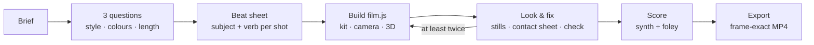
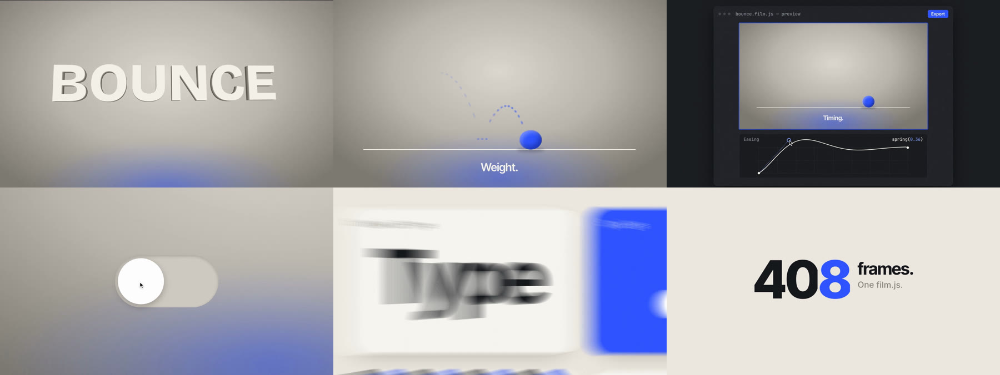
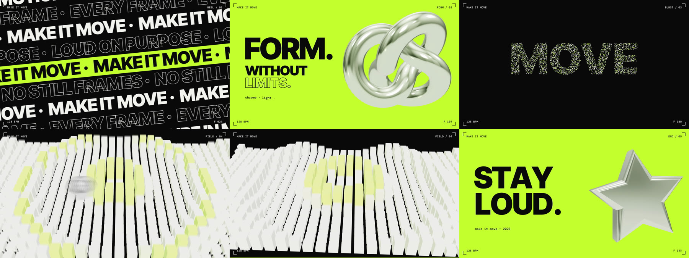
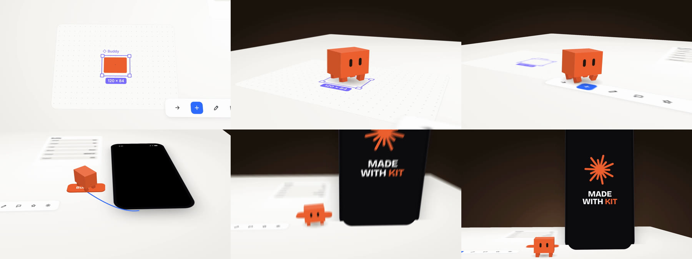
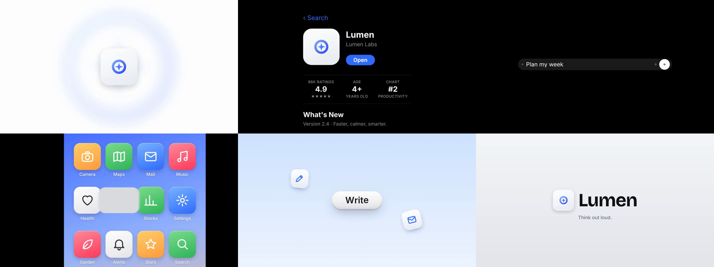
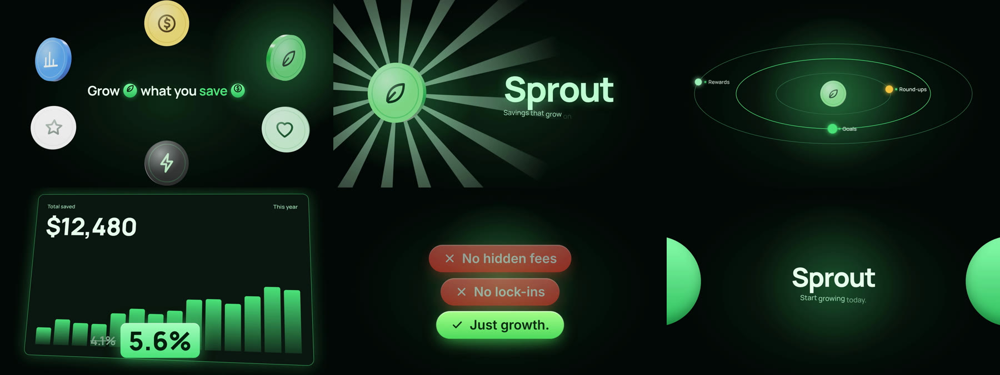

<p align="center">
  
</p>

<h1 align="center">Claude Motion</h1>

<p align="center">
  <strong>Code-Driven Motion Films & Deterministic Video Renderer for AI Coding Agents</strong><br/>
  One continuous camera through one world: real DOM UI, Three.js 3D space, procedural audio scoring, and frame-exact MP4 export.
</p>

<p align="center">
  
  
  
  
  
</p>

<p align="center">
  
  <br/><sub>From <a href="examples/launch/BEATS.md"><code>examples/launch</code></a>: a chart's dip becomes the way into a 3D city. Rendered by this repo, no editing.</sub>
</p>

---

## Why: Code-Driven Motion Films vs. Animated Slideshows

Ask most AI agents for a product video or launch clip, and you receive an animated slideshow: a centered card fading in, followed by another panel dissolving over a static background. **Claude Motion makes films.** It runs your coding agent through the deliberate discipline of a professional motion designer: establishing three looks tailored to your brand, structuring a beat sheet with dynamic camera actions, building on a dedicated deterministic stage, visually inspecting intermediate frames, procedurally scoring beats, and rendering frame-exact 1080p MP4s.

### The Slideshow & Animated Deck Trap

Automated film quality is measured using empirical motion heuristics calibrated against real films (`scripts/lib/analyze.mjs`):

- **Pixel Travel Heuristic (`change2s`)**: Over any 2-second window, genuine motion films exhibit **18%–30% whole-picture pixel change** driven by travelling camera moves, perspective changes, and spatial transitions. In contrast, animated decks average only **9%–12% change**, betraying static layouts where only isolated badges or text lines update.
- **Center-Line Weight Bias (`cxSd`)**: Animated decks keep their visual mass anchored to the center line with low horizontal centroid variance (`cxSd < 0.04`), leaving over 60% of canvas corners empty (`sparse`). True films exploit asymmetrical shot framing, wide-to-tight camera push-ins, and directional momentum.
- **Layout Stagnation (`same`)**: Slideshow-style videos repeat the same card template across the timeline (`same > 45%`). Claude Motion scripts flag frozen spans (`> 25%` frozen = slideshow warning) and reject runs that fail travel thresholds.

### The Motion Design Methodology

| Stage | Capability & Verification |
|---|---|
| **Asks first** | Style, colours, and length in one intake pass: three visual looks tailored for your story, brand palette extracted directly from your codebase, and three target durations. No back-and-forth guessing. |
| **Directs** | A beat sheet with one unified world, a continuous camera spine, active verbs in every shot, and eye-leading transitions, tested against the built-in *slideshow test*. |
| **Builds** | A deterministic DOM + Three.js stage: perspective camera with logarithmic zoom and drift continuity, CSS 3D space (`kit.space`), arcing cursor, monotonic typist, word-by-word TextFx, kinetic type walls, springs, squash and stretch, morphs, extruded 3D geometry, walk-cycle box characters, chrome/glass/particles, device UI, and temporal optical motion blur. |
| **Looks** | Exact stills and labeled contact sheets (`scripts/frames.mjs`) that the agent must inspect, coupled with automated checkers for frozen spans, non-determinism, blank first frames, and sub-20px mobile-unreadable text (`scripts/check.mjs`). |
| **Scores** | An offline procedural synth (marimba, electric piano, ambient pads, drum kit, 13 UI foley sounds) synchronized to exact timeline beats, loudness-normalized to broadcast standards (`scripts/score.mjs`). |
| **Ships** | Frame-exact H.264 + AAC encoded via parallel headless Chromium browser workers, with half-resolution draft modes for rapid timing iteration (`scripts/export.mjs`). |

---

## Architecture & Workflow: How It Works

### Pure-Function Timeline Architecture (Deterministic Rendering)

A Claude Motion film lives in a self-contained directory governed by a `film.js` script adhering to a strict mathematical interface contract:

1. **`init(kit)` (One-time asynchronous stage construction)**:
   Builds the DOM tree, sets up camera viewports, compiles shaders, and initializes Three.js scene graphs once.
2. **`render(t, kit)` (Pure mathematical function of time)**:
   Computes the exact visual state of the entire universe for any timestamp $t \in [0, \text{duration}]$:
   $$\text{Frame}(t) = \text{render}(t, \text{kit})$$
   - **No State Accumulation**: State does not leak across frames. Rendering frame $N$ after frame $N-1$ produces the exact same pixel buffer as rendering frame $N$ directly after frame $100$, or scrubbing backwards.
   - **No Non-Deterministic APIs**: Standard browser `Math.random()` and wall-clock timers (`setTimeout`, `requestAnimationFrame`) are replaced by deterministic pseudo-random generators (`kit.rng`), value noise (`kit.vnoise`), and explicit timeline math.
   - **Parallel Frame Distribution**: Because any frame can be rendered independently in any order, multi-core exporters (`scripts/export.mjs`) slice frame intervals across parallel headless Chromium workers with bit-identical repeatability.

### The Directing Pipeline



---

## Comparison: Claude Motion vs. Traditional Video Tools

Claude Motion is engineered specifically for autonomous AI agents that code, inspect, and export broadcast-quality video directly within a repository:

| Feature / Dimension | Claude Motion | Remotion | Motion Canvas | Traditional Slideshow / Deck Generators |
|---|---|---|---|---|
| **Primary Target User** | Autonomous AI coding agents (Claude Code, Codex, OpenCode, Pi) | Frontend React developers | Programmers writing TypeScript animations | End users creating slide presentations |
| **Directorial Lifecycle** | Built-in (3-question intake → beat sheet → build → look/fix loop) | Manual (developer plans and codes components) | Manual (developer codes procedural generators) | Template-driven (slide cards with entrance fades) |
| **Scene Graph & Space** | Hybrid DOM (crisp HTML/CSS) + Three.js 3D + CSS 3D space (`kit.space`) | React DOM components | HTML5 2D Canvas | Flat 2D layout boxes |
| **Motion Philosophy** | One continuous camera through one world; match cuts & handoffs | Composition & timeline sequence transitions | Procedural vector generator functions | Sequential card dissolves & title fades |
| **Audio Pipeline** | Integrated procedural offline synthesizer (notes, drums, UI foley, LUFS normalization) | External audio files imported manually | External audio files imported manually | Silent or canned background music loops |
| **Quality Verification** | Automated CLI checks (`check.mjs`, `review.mjs`) measuring pixel travel & deck smells | Manual visual inspection | Manual visual inspection | None (subjective) |
| **Runtime Overhead** | Zero framework dependencies; single vanilla JS runtime + bundled Three.js | Node + React + Webpack / Vite bundler | Node + Vite bundler | Heavy web UI or cloud rendering service |

---

## Supported Film Genres & Reference Implementations

Each genre includes a reference implementation with an accompanying beat sheet. Coding agents inspect the closest match when planning a new film:

### 1. Product Launches & UI Walkthroughs (`examples/launch`)
A 34-second flagship product launch film: an interactive web application chart dips into a continuous 3D city traversal, pulls back into code reviews, and resolves into an end card.

### 2. Abstract Conceptual Stories (`examples/journey`)
A 22-second conceptual narrative demonstrating how data travels globally without bullet points or slide decks. A continuous camera scales seamlessly from finger-scale typing to planetary map projections and back.

<p align="center"></p>

### 3. Motion-Design Showreels & Kinetic Typography (`examples/reel`, `examples/poster`)
High-tempo kinetic typography and showcase reels. Letters extrude in 3D space, characters transform into squash-and-stretch bouncing spheres, toggles flood color fields, and camera whip pans traverse graphic grids with real optical motion blur.

<p align="center"></p>

### 4. 3D Spatial Tabletop & Character Animation (`examples/tabletop`)
Real UI layouts projected onto physical desk plates inside CSS 3D space (`kit.space`), navigated by an animated walking box character with distance-driven leg kinematics and shallow depth-of-field blurring.

### 5. Mobile App & Brand Promos (`examples/app-promo`, `examples/brand-promo`)
App store sequences, phone device shells, icon interactions, glossy 3D coins, volumetric light rays, and interactive claim pills.

| | |
|:---:|:---:|
| <br/>**Kinetic poster**: type walls, chrome 3D, particles that form words (`examples/poster`) | <br/>**3D tabletop**: real UI on a desk in CSS 3D, a walking character (`examples/tabletop`) |
| <br/>**App promo**: icon → store page → prompt → home screen → pills (`examples/app-promo`) | <br/>**Brand promo**: glossy coins, rays, tilted dashboard, ✕/✓ claims (`examples/brand-promo`) |

Underneath every genre:
- **CSS 3D space (`kit.space`)**: Crisp DOM elements rendered on 3D planes under a true perspective camera.
- **Box characters**: Procedural walk cycles with automatic leg alternating and foot planting (`gait`).
- **`three-kit.js`**: Reusable 3D primitives (chrome, glass, coins, stars, knots, particles, instanced fields).
- **`ui/devices.js`**: Vector-crisp device hardware shells (smartphones, browsers, app icons, store pages, prompt inputs, pill tags).
- **Scrolling type walls**: Dynamic text streams, word-by-word revealers, and inline animated icon typography.

---

## Style Presets & Visual Systems

Six complete visual identities provide cohesive palettes, procedural background shaders, and typography systems out of the box. Switching themes requires changing a single preset identifier in `film.js`. Alternatively, agents can extract existing design tokens directly from your codebase:

<p align="center"></p>

- `sketch`: Technical blueprint, warm grid background, drafted hand-drawn accents.
- `bubbles`: High-energy consumer aesthetic with pastel gradients and bouncy springs.
- `editorial`: Refined serif typography, monochrome balance, and warm neutral paper grounds.
- `bold`: High-contrast brutalist layout, sharp typography, and punchy saturated accents.
- `midnight`: Deep dark-mode interface, glowing glass panels, and neon emission shaders.
- `showcase`: Product-focused studio lighting, subtle chrome materials, and elevation shadows.

Explore full preset rules and contrast tokens in [references/styles.md](references/styles.md). Color contrast ratios can be validated via `node scripts/palette.mjs`.

---

## Directing Workflows & Example Prompts

Agents parse natural language briefs into structured beat sheets before touching code:

> "Make a 25-second teaser for the app in this repo: the user types a task, the board reorganises itself, and it ends on our logo. Use our brand colours. Export an MP4."

> "A 40-second explainer of how our sync engine resolves a conflict, in 3D: two devices, an edit on each, the merge, the result."

> "Storyboard a vertical 20-second launch clip first; wait for my OK before building it."

> "At 0:12 the button click feels late. Move it earlier and keep everything else."

---

## CLI Toolchain & Workflow Commands

### Scaffolding & Setup
- `node scripts/new.mjs <film-dir> [--style <preset>] [--portrait] [--square]`: Scaffolds a new film project with starter timeline and assets.
- `node scripts/doctor.mjs`: Diagnoses Node version, Playwright, Chromium, WebGL availability, and FFmpeg installation with actionable remediation steps.

### Interactive Preview & Inspection
- `node scripts/preview.mjs <film-dir>`: Launches interactive browser player with scrubbing, spacebar play/pause, frame-stepping (`←`/`→`), looping (`L`), and audio mute (`M`).
- `node scripts/frames.mjs <film-dir> --at <timestamps> [--sheet]`: Captures pixel-exact stills at specified timestamps or generates a labeled contact sheet.

### Quality Control & Deck Heuristics
- `node scripts/check.mjs <film-dir>`: Evaluates determinism, non-blank first frame, frozen durations, animated deck signals (`change2s`, `cxSd`), and text legibility (< 20px).
- `node scripts/review.mjs <video.mp4> [--sheet <sheet.jpg>]`: Analyzes any exported MP4 video (including external or AI-generated models) for audio levels, frozen spans, and layout stagnation.

### Procedural Audio & Palette Tools
- `node scripts/palette.mjs "#ground,#main,#ink,#accent"`: Validates WCAG contrast ratios and tonal relationships across film color palettes.
- `node scripts/score.mjs <film-dir> [--levels]`: Synthesizes musical score and foley events into a broadcast-normalized `score.wav`.

### Deterministic Rendering & Export
- `node scripts/export.mjs <film-dir> [options]`: Renders frame-exact H.264 video with synchronized audio and motion blur across parallel headless workers.
- `npm test`: Runs test suite across kit math, easing curves, camera motion, procedural synthesis, and browser rendering determinism.

---

## Export Options & Formats

The rendering engine (`scripts/export.mjs`) exports frame-exact MP4 videos and high-fidelity animated GIFs:

| Flag | Default | Description |
|---|---|---|
| `<film-dir>` | *(Required)* | Path to the film project directory containing `film.js`. |
| `--out <path>` | `<film-dir>/film.mp4` | Custom output destination path for the rendered MP4 or GIF. |
| `--fps <n>` | `info.fps` (30) | Video framerate (e.g. `24`, `30`, `60`). |
| `--scale <factor>` | `1.0` | Output resolution scale factor (`0.5` = 540p, `1.0` = 1080p, `2.0` = 4K). |
| `--from <s>` | `0` | Starting timestamp in seconds for partial renders. |
| `--to <s>` | `info.duration` | Ending timestamp in seconds for partial renders. |
| `--draft` | Disabled | High-speed draft export: sets `--scale 0.5`, `--fps 24`, `--crf 23`, `--preset veryfast`, and disables motion blur for rapid timing verification. |
| `--jobs <n>` | `min(6, CPUs)` | Number of parallel headless Chromium browser workers. Workload is partitioned linearly across instances without thread contention. |
| `--blur <samples>` | Film setting | Sub-frame temporal supersampling. Automatically increases sample density (16–32 samples) during high-velocity camera pans to eliminate strobing. |
| `--no-blur` | Disabled | Bypasses motion blur computation to accelerate export. |
| `--gif <path>` | None | Produces a 2-pass dithered animated GIF utilizing dual-pass palette generation (`palettegen=stats_mode=diff` + `paletteuse=dither=sierra2_4a`). |
| `--audio <file.wav>` | Auto-synthesized | Custom audio soundtrack. If omitted and `--no-audio` is not specified, automatically invokes `score.mjs` to synthesize `score.wav`. |
| `--no-audio` | Disabled | Generates a silent video track. |
| `--crf <n>` | `16` | Constant Rate Factor for x264 video encoding (lower = higher quality; `16` yields near-lossless archival quality; `--draft` defaults to `23`). |
| `--preset <speed>` | `slow` | FFmpeg x264 compression efficiency preset (`ultrafast`, `veryfast`, `medium`, `slow`). |

---

## Rendering Performance Benchmarks

Rendering performance scales predictably based on visual scene complexity and available hardware rasterization:

- **2D DOM Animation (HTML/CSS & Typography)**:
  - Latency: **~0.05 seconds per frame** (~20 fps render throughput per CPU core).
  - Benchmark: A standard 30-second 1080p @ 30fps film (900 frames) exports in **~45 seconds** across 4–6 parallel workers.
- **3D Three.js Animation (Headless CPU Software WebGL)**:
  - Latency: **~1.0–2.0 seconds per frame** when rendered in software via SwiftShader/Chromium CPU rasterization.
  - Benchmark: The 34-second flagship product launch (`examples/launch`, featuring 18 seconds of dense 3D city traversal) exports in **~16 minutes** on a 4-core CPU without a dedicated GPU.
- **3D Three.js Animation (GPU-Accelerated WebGL)**:
  - Latency: **Sub-second per frame** (< 0.2s) when headless Chromium accesses hardware GPU drivers.
  - Benchmark: Reduces 3D film export times by 5×–8×, completing full 1080p exports in **2–3 minutes**.
- **Multi-Worker Concurrency Scaling**:
  - Exporters slice frame intervals linearly: worker $w$ of $J$ jobs renders frames $[w \cdot N / J, (w+1) \cdot N / J)$. Independent browser contexts eliminate lock contention and scale linearly with physical CPU cores.

---

## Installation & Agent Setup

### Claude Code Plugin

Install directly into Claude Code via the plugin marketplace:

```text
/plugin install motion-films --marketplace TheOnlyFusionCube/claude-motion
```

### Skill-Aware Agents (Codex, OpenCode, Pi)

Install via the universal skills manager:

```bash
npx skills add TheOnlyFusionCube/claude-motion
```

### Manual Installation Paths

Copy the repository into your agent's designated skills directory:

| Agent | Project Scope | User Scope |
| --- | --- | --- |
| Claude Code | `.claude/skills/claude-motion/` | `~/.claude/skills/claude-motion/` |
| Codex | `.agents/skills/claude-motion/` | `~/.agents/skills/claude-motion/` |
| OpenCode | `.opencode/skills/claude-motion/` | `~/.config/opencode/skills/claude-motion/` |
| Pi | `.pi/skills/claude-motion/` | `~/.pi/agent/skills/claude-motion/` |

### System Requirements & Environment Diagnostics

Verify system readiness using the built-in diagnostic tool:

```bash
node scripts/doctor.mjs
```

The script inspects your runtime environment and outputs precise commands for any missing components:
- **Node.js**: Version $\ge 22.0.0$.
- **Playwright + Chromium**: Headless browser automation (`npm i -D playwright && npx playwright install chromium`).
- **FFmpeg**: Required for H.264 video assembly, AAC audio multiplexing, and palette-optimized GIF creation.
- **WebGL**: Hardware GPU acceleration when available; transparent software rendering fallback.

---

## What's Inside the Repository

```text
SKILL.md                 The method: intake questions → beat sheet → build → look & fix → sound → export
kit/                     motion-kit.js (runtime) · three-kit.js (3D) · ui/devices.js · player.html · styles/ (presets) · fonts/ · vendor/ (Three.js)
scripts/                 doctor · new · preview · frames · check · review · palette · score · export
templates/               starter (the grammar) · preset (a film on a style preset)
examples/launch/         34 s launch film: app → chart → 3D city → comment → replay → end card
examples/journey/        22 s abstract story: one message from phone to ocean to phone
examples/reel/           13 s motion-design reel: extruded type, squash & stretch, morphs, whips, motion blur
examples/poster/         12.5 s kinetic poster: type walls, chrome knot, particles → word, block field
examples/tabletop/       11 s 3D tabletop: UI plates on a desk, a walking box character, depth of field
examples/app-promo/      12.6 s app promo: icon → store page → prompt → home screen → glossy pills
examples/brand-promo/    14 s brand promo: 3D coins, rays, icons in sentences, tilted dashboard, claims
examples/styles/         One scene per style preset
references/              intake · styles · kit-api · recipes · upstream/ (the original Motion docs, verbatim)
```

---

## Frequently Asked Questions (FAQ)

### Does it need a dedicated GPU?
No. Chromium automatically falls back to software WebGL rasterization when a physical GPU is absent. 2D DOM frames render in ~0.05 seconds each, and 3D frames take ~1.0–2.0 seconds in software mode. The 34-second flagship film (`examples/launch`, containing 18s of 3D geometry) exports in ~16 minutes on a 4-core machine without a GPU. With hardware acceleration, 3D exports complete in under 3 minutes. While developing, agents render stills of changed beats using `scripts/frames.mjs` rather than full video exports.

### Can it use my real product UI?
Yes, and it is explicitly instructed to do so. The skill guides the coding agent to inspect your project's components, layouts, and CSS files to match exact DOM elements, tokens, and visual styling. Speculative or conceptual UI is clearly marked on end cards.

### Can I add a voice-over or custom narration?
Yes. Claude Motion automatically synthesizes synchronized musical scores and foley effects to `score.wav`. To include voice narration, mix your voiceover track into a WAV file and pass it during export:
```bash
node scripts/export.mjs my-film --audio narration_mix.wav
```

### Which coding agents and LLM models are supported?
Any agent capable of executing Node.js and loading Agent Skills (Claude Code, Codex, OpenCode, Pi). Creative output and visual subtlety scale with model capabilities, but the structured intake methodology, reference beat sheets, and automated look-and-fix feedback loop ensure consistent, non-deck results across models.

---

## Notes & Upstream Verification

An independent open-source project. Not affiliated with, sponsored by, or endorsed by Anthropic. The original reference documentation in `references/upstream/` is preserved verbatim; see [NOTICE.md](NOTICE.md) and [SOURCE.md](SOURCE.md). Verification of upstream document hashes can be performed at any time:
```bash
npm run verify-upstream
```
Bundled typography is licensed under SIL OFL 1.1 (`kit/fonts/LICENSE.md`); Three.js is licensed under MIT. Full version history is detailed in [CHANGELOG.md](CHANGELOG.md).
