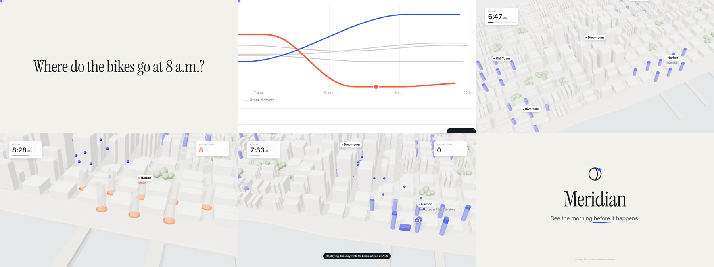

<h1 align="center">claude-motion</h1>

<p align="center">
  <strong>Launch-quality motion films, written in code by your coding agent.</strong><br/>
  An Agent Skill for Claude Code, Codex, OpenCode, Pi and other skill-aware agents.
</p>

<p align="center"></p>

---

Ask your agent for a product teaser, a launch film, an animated explainer or a data story, and you
get a **film**: one camera travelling through one world, a subject that changes in every shot,
transitions that carry the eye, type that moves with meaning, an original score, and a frame-exact
1080p MP4. You don't get an animated slideshow.

It's built from three parts:

1. **A deterministic film runtime** (`kit/`). A DOM stage, so type and UI stay crisp at any zoom, plus
   Three.js for real 3D. It includes a camera with drift and log-space zoom, an arcing cursor with
   clicks, a typist, streamed text, word-by-word type effects, hand-drawn boiling marks, springs and
   keyframes. Everything is a pure function of `t`, so any frame renders identically in any order.
2. **A direction method** (`SKILL.md`). A beat sheet where every beat has a subject and a verb, one
   world and one spine, transitions that say how the subject carries, a slideshow test, and a mandatory
   look-and-fix loop on real rendered stills. It's grounded in the original Motion craft rules
   (`references/upstream/motion.md`).
3. **Tools that let the agent see** (`scripts/`). Exact stills and contact sheets, a check for
   non-determinism, frozen spans, slideshow-shaped motion and phone-unreadable text, a synth that
   turns `score(S)` into a WAV, and a parallel MP4 exporter.

## The example

`examples/launch/` is a 34 s launch film for a fictional bike-share ops tool. A question becomes a
prompt in an app, the answer is a chart, the camera pushes through the chart's dip into a 3D city
where Harbor runs out of bikes, a comment proposes a fix, and a replay shows it working. It ends on a
logo built from the comment's pin. See its [beat sheet](examples/launch/BEATS.md).

```bash
node scripts/preview.mjs examples/launch                 # open the printed URL; space plays
node scripts/export.mjs examples/launch --out meridian.mp4
```

## Install

```bash
npx skills add TheOnlyFusionCube/claude-motion
```

Or copy this folder to your agent's skills directory: `~/.claude/skills/claude-motion/` (Claude Code),
`~/.agents/skills/claude-motion/` (Codex), `~/.config/opencode/skills/claude-motion/` (OpenCode),
`~/.pi/agent/skills/claude-motion/` (Pi).

Rendering needs **Node ≥ 22**, **Playwright + Chromium** (`npm i -D playwright && npx playwright install chromium`)
and **FFmpeg**. 3D uses your GPU if headless Chrome can reach it, and otherwise falls back to software
(slower, same result).

## Ask for things like

> Make a 25-second teaser for the app in this repo: the user types a task, the board reorganises
> itself, and it ends on our logo. Use our brand colours and fonts. Export an MP4.

> A 40-second explainer of how our sync engine resolves a conflict, in 3D. Two devices, an edit on
> each, the merge, the result.

> Storyboard a vertical 20 s launch clip first; wait for my OK before building it.

> At 0:12 the button click feels late. Move it earlier and keep everything else.

## Commands

| | |
|---|---|
| `node scripts/new.mjs my-film` | scaffold a film from the starter |
| `node scripts/preview.mjs my-film` | player with scrubbing, frame stepping and sound |
| `node scripts/frames.mjs my-film --at 0,2.5,c2,end --sheet` | exact stills plus a contact sheet |
| `node scripts/check.mjs my-film` | determinism, first frame, frozen spans, slideshow smell, tiny text |
| `node scripts/score.mjs my-film --levels` | render the score to `score.wav` |
| `node scripts/export.mjs my-film --out film.mp4` | frame-exact H.264 + AAC (`--fps 60`, `--gif`) |
| `npm test` | kit and synth unit tests |

## What changed in 2.0

Version 1.x stacked rules, validators and parity claims on top of a weak Canvas starter, and
agents still produced lightly animated slideshows. 2.0 replaces all of that with a real runtime that
mirrors the original Motion `kit` API, a flagship example film to learn from, a short and opinionated
SKILL.md built around the beat sheet and the look-fix loop, and tools that render what the viewer
will actually see. See [CHANGELOG.md](CHANGELOG.md).

## Notes

This is an independent project, not Anthropic's Motion player, and not affiliated with or endorsed by
Anthropic. The original reference documents in `references/upstream/` are kept verbatim; see
[NOTICE.md](NOTICE.md) and [SOURCE.md](SOURCE.md). Bundled fonts are SIL OFL 1.1 (Fontsource) and
Three.js is MIT. See `kit/fonts/LICENSE.md` and `kit/vendor/THREE-LICENSE`.
