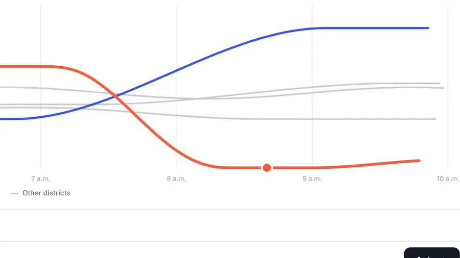
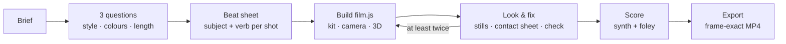
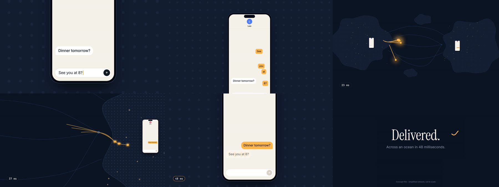
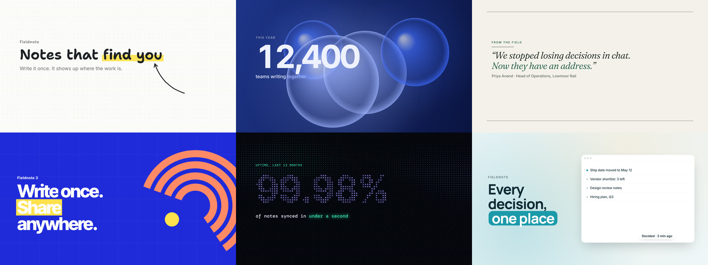

<p align="center">
  
</p>

<h1 align="center">Claude Motion</h1>

<p align="center">
  <strong>Launch-quality motion films, directed and rendered by your coding agent.</strong><br/>
  Not animated slideshows: one camera through one world, real UI, real 3D, an original score, frame-exact MP4.
</p>

<p align="center">
  
  
  
  
  
</p>

<p align="center">
  
  <br/><sub>From <a href="examples/launch/BEATS.md"><code>examples/launch</code></a>: a chart's dip becomes the way into a 3D city. Rendered by this repo, no editing.</sub>
</p>

---

## Why

Ask most agents for a launch video and you get a slideshow: a title card, then a panel fading in,
then another panel. **Claude Motion makes films.** It runs your agent through the process a motion
designer would use. It asks the three questions that decide the look, writes a beat sheet where
every shot has a subject and an action, builds on a runtime made for this, renders real frames,
looks at them, fixes what's off, scores the film, and exports a 1080p MP4.

| | |
|---|---|
| **Asks first** | Style, colours and length, in one go: three looks invented for your film, your brand palette (found in your codebase), three lengths that fit. No "I wish I'd said…" |
| **Directs** | A beat sheet with one world, one spine, a verb in every shot and a transition that carries the eye, checked against a built-in *slideshow test* |
| **Builds** | A deterministic DOM + Three.js stage: camera with drift and log-zoom, arcing cursor, typing, streamed answers, word-by-word type, hand-drawn marks, springs, 3D clay worlds |
| **Looks** | Exact stills and contact sheets the agent must read, plus a checker for frozen spans, non-determinism, blank first frames and phone-unreadable text |
| **Scores** | An offline synth (marimba, EP, pads, kit, UI foley) timed to the same beats as the picture, loudness-normalised |
| **Ships** | Frame-exact H.264 + AAC from parallel headless browsers, with half-size drafts for checking timing |

## Install

**Claude Code** (plugin):

```text
/plugin install motion-films --marketplace TheOnlyFusionCube/claude-motion
```

**Any skill-aware agent** (Claude Code, Codex, OpenCode, Pi…):

```bash
npx skills add TheOnlyFusionCube/claude-motion
```

<details>
<summary>Or copy the folder by hand</summary>

| Agent | Project | User |
| --- | --- | --- |
| Claude Code | `.claude/skills/claude-motion/` | `~/.claude/skills/claude-motion/` |
| Codex | `.agents/skills/claude-motion/` | `~/.agents/skills/claude-motion/` |
| OpenCode | `.opencode/skills/claude-motion/` | `~/.config/opencode/skills/claude-motion/` |
| Pi | `.pi/skills/claude-motion/` | `~/.pi/agent/skills/claude-motion/` |

</details>

Then check the machine. The doctor prints the exact fix for anything missing:

```bash
node scripts/doctor.mjs
```

Rendering needs **Node ≥ 22**, **Playwright + Chromium** (`npm i -D playwright && npx playwright install chromium`)
and **FFmpeg** for MP4. 3D uses your GPU when headless Chrome can reach it, and software rendering otherwise.

## How it works



A film is one folder with a `film.js`: `init` builds the stage once, and `render(t)` sets everything on it
as a pure function of time. Any frame renders the same in any order, so scrubbing, stills, checks and
parallel export all agree. The API mirrors the original Motion `kit`, so its craft rules apply directly.

## Abstract stories, too

Ideas don't need slides. `examples/journey/` tells how a message crosses the world with one subject,
a camera that goes from finger scale to map scale and back, and almost no words on screen.

<p align="center"></p>

## Style presets

Six ready-made looks with named palettes, animated backdrops and their own emphasis animation. They share
one set of classes, so switching the look is a one-word change. Or skip presets and let the agent design a
look for your film.

<p align="center"></p>

`sketch` · `bubbles` · `editorial` · `bold` · `midnight` · `showcase`. See [references/styles.md](references/styles.md).

## Ask for things like

> Make a 25-second teaser for the app in this repo: the user types a task, the board reorganises itself,
> and it ends on our logo. Use our brand colours. Export an MP4.

> A 40-second explainer of how our sync engine resolves a conflict, in 3D: two devices, an edit on each,
> the merge, the result.

> Storyboard a vertical 20-second launch clip first; wait for my OK before building it.

> At 0:12 the button click feels late. Move it earlier and keep everything else.

## Commands

| | |
|---|---|
| `node scripts/doctor.mjs` | check Node, Playwright, Chromium, WebGL, FFmpeg, with fixes |
| `node scripts/new.mjs my-film [--style editorial]` | scaffold a film (optionally on a preset); `--portrait`, `--square` |
| `node scripts/preview.mjs my-film` | player: scrub, space, ←/→ frame step, L loop, M mute |
| `node scripts/frames.mjs my-film --at 0,2.5,c2,end --sheet` | exact stills plus a labelled contact sheet |
| `node scripts/check.mjs my-film` | determinism, first frame, frozen spans, animated-deck signals, tiny text |
| `node scripts/review.mjs film.mp4 --sheet sheet.jpg` | review **any** video (from any tool or model): sound, loudness, frozen time, animated-deck signals |
| `node scripts/palette.mjs "#ground,#main,#ink,#accent"` | contrast-check a palette before using it |
| `node scripts/score.mjs my-film --levels` | render the score to `score.wav` |
| `node scripts/export.mjs my-film [--draft] [--fps 60] [--gif x.gif]` | frame-exact MP4 with the score (`--draft`: half size, fast) |
| `npm test` | runtime, synth and in-browser render tests |

## What's inside

```text
SKILL.md                 the method: questions → beat sheet → build → look & fix → sound → export
kit/                     motion-kit.js (runtime) · player.html · styles/ (presets) · fonts/ (10 OFL families) · vendor/ (Three.js)
scripts/                 doctor · new · preview · frames · check · review · palette · score · export
templates/               starter (the grammar) · preset (a film on a style preset)
examples/launch/         34 s launch film: app → chart → 3D city → comment → replay → end card
examples/journey/        22 s abstract story: one message from phone to ocean to phone
examples/styles/         one scene per preset
references/              intake · styles · kit-api · recipes · upstream/ (the original Motion docs, verbatim)
```

## FAQ

**Does it need a GPU?** No. Without one, Chromium renders WebGL in software. 2D frames take ~0.05 s each and
3D frames ~1–2 s, so the 34 s example (18 s of 3D) took about 16 minutes on a 4-core machine with no GPU. 2D films export in
well under a minute. With a GPU, 3D is much faster. While iterating, render stills of the beat you changed
rather than whole exports.

**Can it use my real product UI?** Yes, and it should: the skill tells the agent to read your components and CSS
and match exact values. Speculative UI is labelled as a concept on the end card.

**Voice-over?** The score and foley are generated. To add narration, mix it into a WAV and pass
`export.mjs --audio mix.wav`.

**Which agents and models?** Any agent that loads Agent Skills and can run Node. Results scale with the model's
taste, but the method, example and look-and-fix loop are what lift a run from slideshow to film.

## Notes

An independent project. It isn't Anthropic's Motion player and isn't affiliated with or endorsed by Anthropic.
The original reference documents in `references/upstream/` are kept verbatim; see [NOTICE.md](NOTICE.md) and
[SOURCE.md](SOURCE.md). Bundled fonts are SIL OFL 1.1 (`kit/fonts/LICENSE.md`); Three.js is MIT. Release notes:
[CHANGELOG.md](CHANGELOG.md).
