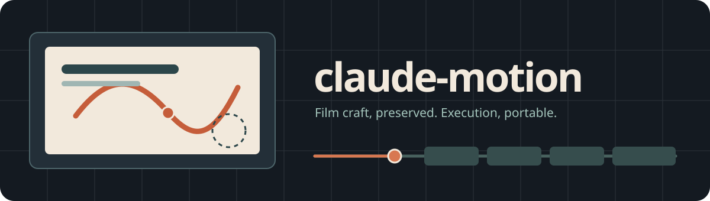

<p align="center">
  
</p>

<h1 align="center">claude-motion</h1>

<p align="center">
  <strong>Motion direction for coding agents, with the original craft guidance preserved.</strong><br/>
  An unofficial, standalone Agent Skill for Claude Code, Codex, OpenCode, Pi and other skill-aware agents.
</p>

<p align="center">
  <a href="#install">Install</a> · <a href="#what-it-makes">Examples</a> · <a href="#how-it-works">How it works</a> · <a href="#source-fidelity">Source fidelity</a> · <a href="#development">Development</a>
</p>

---

## What it does

Beyond kinetic typography, this release adds a **camera-driven 3D data-film route** and a **narrated launch-film editing route**, designed for the scope of videos like the [Claude Dashboards and Claude Motion launch demo](https://youtu.be/en0GuyhieQk). The link is a creative capability reference, not an asset included in this project and not evidence of proprietary runtime parity.

Give your coding agent a brief, a product screen, or an existing animation. `claude-motion` teaches it to make a considered film, not a collection of generic UI effects:

- **Sustain uninterrupted, purposeful motion** with the original source's quiet hold pushes/drifts/breaths, tracked subjects, meaningful handoffs and kinetic typography; no frozen slideshow panels.
- **Show real product behavior** using source-first UI reproduction, meaningful cursor movement, and readable close-ups.
- **Build deterministic timelines** so a frame at time `t` looks the same no matter how the playhead got there.
- **Synchronize an original score** and UI foley to exact visual events.
- **Animate asset-led 3D worlds** with authored GLB models, Blender studio-light presets, real materials, linked instances, time-linked metrics, camera cuts and world-space routes.
- **Assemble narrated product launches** from authorized screen recordings, a supplied voice track, and code-rendered motion scenes.
- **Review the actual frames** before calling a film finished; revise targeted beats without gratuitous redesigns. A self-demo must show causal motion, not static feature cards.

This is an **independent coding-agent adaptation**, not Anthropic's Motion player. Documentation parity and the feature/visual parity of a proprietary runtime are different claims.

## Install

From a terminal with a skill installer:

```bash
npx skills add TheOnlyFusionCube/claude-motion
```

Or clone the repository and copy the whole directory into the skills location for your agent:

| Agent | Project location | User location |
| --- | --- | --- |
| **Claude Code** | `.claude/skills/claude-motion/` | `~/.claude/skills/claude-motion/` |
| **Codex** | `.agents/skills/claude-motion/` | `~/.agents/skills/claude-motion/` |
| **OpenCode** | `.agents/skills/claude-motion/` or `.opencode/skills/claude-motion/` | `~/.config/opencode/skills/claude-motion/` |
| **Pi** | `.agents/skills/claude-motion/` or `.pi/skills/claude-motion/` | `~/.pi/agent/skills/claude-motion/` |

**Example:** from the parent directory of a cloned `claude-motion` repo:

```bash
mkdir -p ./my-project/.agents/skills
cp -R ./claude-motion ./my-project/.agents/skills/
```

If several agents use your project, use each agent's supported discovery path; don't assume all four read the same folder. The repository root contains the active `SKILL.md` and is the skill folder. No account, Anthropic Artifact API, package install, or network fetch is necessary to read the skill.

## What it makes

Ask your coding agent:

> Use claude-motion to make a 20-second product teaser from the components in this repo. Keep the UI faithful, use gentle camera pushes, and export MP4.

> Storyboard a 30-second vertical launch film with three different visual directions. Wait for my approval before implementation.

> Rework the button click at 12 seconds without moving any other elements. Verify the before and after frames.

> Build a 3D city from this dashboard's station coordinates. Fly the camera from overview to the critical depot, animate actual availability by time, highlight the depletion and show a proposed redistribution; export 1080p MP4.

> Make a narrated 80-second product launch combining a supplied screen recording, dashboard interaction, and a 3D animated data explainer. Keep its UI genuine and deliver an editable cut plan plus the final movie.

> Review this animation against the original Motion craft rules: pacing, camera, readability, cursor path, first frame, and closing hold.

The skill prioritizes the stack your project already uses (for example, Canvas, SVG/DOM, Motion, GSAP, Remotion, or FFmpeg). It also ships an **original, dependency-free browser-film example** for projects without an animation stack.

## Try the included demo

No `npm install` is needed for the browser demo:

```bash
python3 -m http.server 8080 --directory assets/vanilla-film
# Open http://127.0.0.1:8080/
```

A seekable example exposes `window.__motion.seek(seconds)`. The optional local media tools use **Node 22+, Chromium, and FFmpeg** (MP4 only):

```bash
node scripts/inspect.mjs assets/vanilla-film --times 0,3.4,6.25,9.6,13.9 --out ./frames
node scripts/render-audio.mjs assets/vanilla-film --out ./score.wav --levels yes
node scripts/export.mjs assets/vanilla-film --out ./demo.mp4 --audio ./score.wav
```

Visual export depends on a locally available Chromium and FFmpeg. The browser preview is not a replacement for the private Motion player or its audio transport.

## v1.5: continuous-motion first (fixes the animated-slideshow failure)

The original Motion craft source's first principle is **"Everything is always in motion."** This update makes it operational for 15-120s explainers, launch films, product tutorials and end cards, not only short showreels. A held card needs a low-amplitude moving camera/plate or shape **and** a real foreground action per beat; sliding from one static panel to the next is not enough.

- `references/perpetual-motion.md`: measured Ken Burns holds, UI drift, shape breathing, title creep, causal subject handoffs and a concrete redesign plan for the 90s PHP film.
- `assets/vanilla-film/src/motion.mjs`: deterministic `heldPlate`, `uiHoldDrift`, `titleCreep` primitives; end-card example now creeps rather than reversing its title drift.
- `scripts/validate-motion-plan.mjs`: tests **coverage of every shot**, including title/end holds, and demands real focal actions distinct from ambient motion. Example at `examples/continuous-motion/motion-plan.json` and [a runnable 18-second continuous-world demo](examples/continuous-motion/README.md).
- `scripts/audit-video.mjs --continuous`: decodes actual MP4 frames at 2fps, including opening and ending; flags >=3s near-static runs **and** high overall stillness. Music and scene cuts do not excuse dead visual time.

```bash
node scripts/validate-motion-plan.mjs examples/continuous-motion/motion-plan.json --strict
node scripts/audit-video.mjs ./your-film.mp4 --mode launch --continuous --strict --sheet ./qa.png
```

The example now includes an **18-second original continuously tracked 2D scene**, with `build.py` and a small demo MP4, as a concrete non-slideshow mechanism reference. It is not evidence of commercial-level art direction. A passing metadata plan, pixel audit, or test suite alone does not prove compelling visual choreography. Play and review the encoded film to verify meaningful ongoing action; a camera drifting across unchanged text for 90 seconds still fails the creative contract.

## New: optimized asset and studio-lighting pipeline (v1.4)

The more ambitious **Blender-first route** is now in [`examples/blender-studio/`](examples/blender-studio/), with [reusable art-direction and optimization guidance](references/3d-asset-lighting.md). It includes **three original authored GLB models** (an arched transit hub, sculpted reservoir and mixed-use courtyard), an editable scene generator with **PBR materials, three area lights, color-managed rendering, linked instances, shot/lens keys, and time-driven data geometry**, and an independent optimizer/preflight.

The kit is intentionally tiny: about **63 KiB of GLB assets**, **2,584 unique triangles** (6,172 visible across shared nodes) and **zero external texture downloads**. Asset budget and provenance checks run with Python's standard library—no Blender installation required for preflight.

```bash
# Fast zero-dependency audit: source rights, mesh/texture budgets, unsafe URIs.
python3 scripts/3d-preflight.py examples/blender-studio/asset-manifest.json --budget web --strict

# Optional Blender 4+ look-development: draft wide, then close; never render the
# full movie before the hero lighting and material appearance has been approved.
blender --background --python examples/blender-studio/stage.py -- --quality draft --width 960 --time 1.25 --out ./wide.png
blender --background --python examples/blender-studio/stage.py -- --quality review --width 1280 --time 9.3 --out ./detail.png
```

The [included model kit and instructions](examples/blender-studio/README.md) also explain rendering resumable PNG frames, editable `.blend` files and optional `gltfpack` optimization (opt-in Meshopt/KTX2 only when supported). This runtime does **not** include Blender, so the new GLBs were regenerated, inspected in an actual glTF renderer and structurally tested; **the Blender look has not been rendered or visually certified here**. The kit provides the missing asset and lighting workflow, not a guarantee of parity with Anthropic's commercial.

## New: real 3D renderer route (not a 2.5D proxy)

The prior **Pillow-projected 26-second city** was a technically correct proof but visually unimpressive. It is now **explicitly a legacy mathematics test**, not a cinematic-quality sample. For polished 3D, the skill requires real modeled geometry, authored lighting/materials, purposeful camera shots, clear subject hierarchy, and actual frame-by-frame visual review. Read [cinematic 3D craft and production gates](references/cinematic-3d.md).

[**Watch the 18-second, 1080p original VTK example**](examples/studio-city-film/demo.mp4) and [inspect its contact sheet](examples/studio-city-film/qa-contact.png). `examples/studio-city-film/` is a new, original **VTK/OpenGL 3D renderer exercise**, available offline without a browser. It has real scene geometry, instanced architecture, physically projected routes, an authored camera, source-linked depletion/recovery, and a composed sound bed. The runnable source code is included beside the video; the video is provided only as an inspection sample. **It is still not certified at the quality of the commercial reference:** generic procedural architecture needs further art direction, richer assets and credible urban set dressing.

```bash
python3 -m pip install -r examples/studio-city-film/requirements.txt
python3 examples/studio-city-film/render.py --still 9.3 --width 1280 --out ./studio-still.png
python3 examples/studio-city-film/score.py --out ./studio-score.wav
python3 examples/studio-city-film/render.py --width 1920 --fps 24 --out ./studio-picture.mp4
ffmpeg -y -i ./studio-picture.mp4 -i ./studio-score.wav -map 0:v -map 1:a -c:v copy -c:a aac -shortest ./studio-film.mp4
```

For quick data/projection verification on machines without a 3D renderer, the old [2.5D Pillow source](examples/city-data-film/build.py) remains available. **Do not use it as the default visual look for a requested cinematic 3D film.** The new renderer route is a reproducible technical/art-direction baseline, not a substitute for Blender/Three.js production work with assets. Read [3D data filmmaking](references/3d-data-films.md), [narrated hybrid films](references/launch-film.md), and the [reference-readiness matrix](references/reference-readiness.md).

For a narrated hybrid edit, place approved video clips, `voice.wav`, and `score.wav` beside an `edit.json` as specified in `references/launch-film.md`, then run:

```bash
node scripts/assemble-film.mjs ./edit.json --out ./launch-film.mp4
node scripts/audit-video.mjs ./launch-film.mp4 --mode launch --strict --require-audio --sheet ./qa.png
```

The assembler joins real clips and mixes a real supplied voice with music; **it does not generate a presenter's likeness, record a private product by itself or counterfeit shipped UI behavior**.

## See a proof-of-motion concept

[**Watch the 20-second, 1080p original concept film**](examples/showreel-proof/demo.mp4) — a hand-authored reference showing a line becoming an editor, a scrub interaction that changes the preview, and a graphic expanding into the finished composition. This is a **quality benchmark and illustrative concept**, not an auto-generated demonstration of shipped Anthropic features. [See the storyboard and source](examples/showreel-proof/README.md).

## Export-quality gate (recommended)

Valid source code does not imply a good motion film. In particular, a "demo video" should **demonstrate a meaningful action and visible transformation**, not merely explain features on otherwise static cards. See [the showreel brief](references/showreel.md) and [final-delivery gates](references/quality-gates.md).

```bash
node scripts/audit-video.mjs ./demo.mp4 --mode showreel --strict --sheet ./qa-contact-sheet.png
```

This dependency-free Node script uses system FFmpeg/FFprobe to flag undersized exports and long, almost unchanged stretches in the middle of a showreel; it also generates a contact sheet for visual review. It does **not** determine whether the animation is artistically compelling. It needs the actual exported video, and the reviewer must still check shot scale, pacing, readability, cause/effect, and sound sync.

## How it works

```text
SKILL.md                     Portable instructions and source-reading rules
references/upstream/         All 12 original Motion Markdown documents, unchanged
references/portable-*.md     Coding-agent adapter and reusable motion primitives
references/compatibility-map.md
assets/vanilla-film/         Original deterministic Canvas-based film example
scripts/                     Parity, scene validation, frame inspection, final-video audit, audio, export
agents/openai.yaml           Optional ChatGPT skill metadata
tests/                       Determinism, 3D data scene, assembler, audio and source-hash tests
.github/workflows/           CI validation
```

The active skill reads the original creative instructions when appropriate. The adapter deliberately **does not execute historical directions** to call Anthropic-only `ArtifactData`, `show_widget`, `_blob` endpoints, or a proprietary `kit` runtime. Instead it maps the intent to standard files and host-supported tools. See [the portability map](references/compatibility-map.md) and [workflow](references/portable-workflow.md).

## Source fidelity

**100% original-document retention:** 12 of 12 original Markdown files, **159,065 of 159,065 bytes**, verified against pinned upstream Git blob SHA-1 values.

```bash
node scripts/parity.mjs
node scripts/sync-upstream.mjs --verify   # offline verification
```

Source: [public Motion instruction mirror](https://github.com/asgeirtj/system_prompts_leaks/tree/main/Anthropic/artifact-types/motion), pinned to `4ec8ef41a1e0ef32e6f0e9d20b0c18f7e028dc83`. The original entrypoint is archived at `references/upstream/original-skill.md`; the active entrypoint remains this repo's root `SKILL.md`. See [SOURCE.md](SOURCE.md) for the complete hash table and provenance details.

**Important:** "100%" applies to **verbatim source documentation**, not Anthropic's proprietary player, rendering API, editor, UI, sound engine, or measured film quality. There is no claim of affiliation with or endorsement by Anthropic. The mirror's CC0 label does not establish permission from the original rights holder to redistribute its text. Please review the [third-party notice](NOTICE.md) before publishing.

## Development

The skill and its Node tests need no third-party Node dependencies (the optional true 3D exercise additionally uses Python VTK + Pillow + NumPy; the older 2.5D fallback uses Pillow):

```bash
npm test           # automated tests
npm run parity     # original-file SHA check
npm run check      # parity, manifest validation and tests
node scripts/audit-video.mjs your-film.mp4 --mode showreel --strict
```

Avoid modifying `references/upstream/`: the pinned original references must remain byte-identical. Put portability work in `SKILL.md`, `references/portable-*.md`, `scripts/`, or the demo. Contributions: [CONTRIBUTING.md](CONTRIBUTING.md).

## License and credits

- New adapter code, test code and documentation authored for this repo: **MIT**, see [LICENSE](LICENSE).
- Verbatim third-party material under `references/upstream/`: **not covered by that MIT grant**. See [NOTICE.md](NOTICE.md) and [SOURCE.md](SOURCE.md).
- Inspired by the publicly mirrored Motion instructions; comparison repo: [LottieFiles/motion-design-skill](https://github.com/LottieFiles/motion-design-skill). This skill is separate from both projects.
